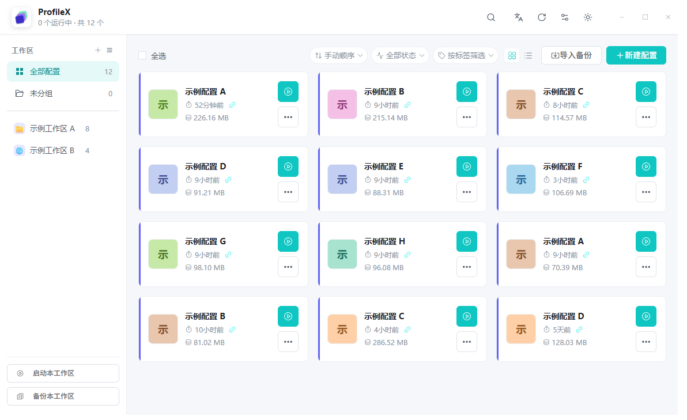
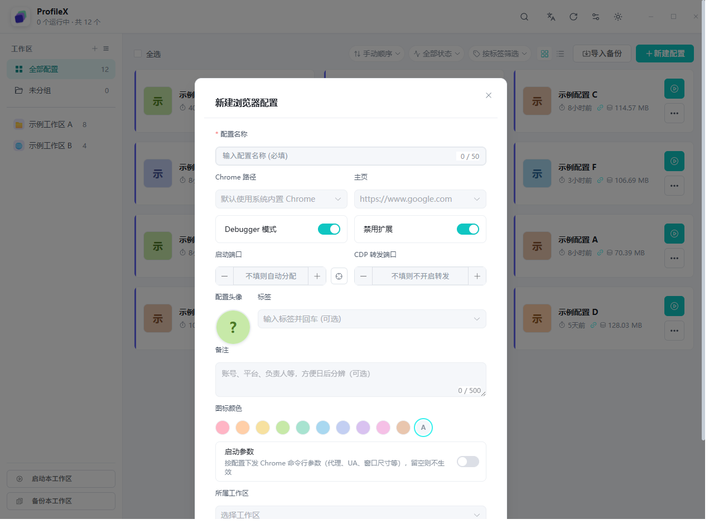
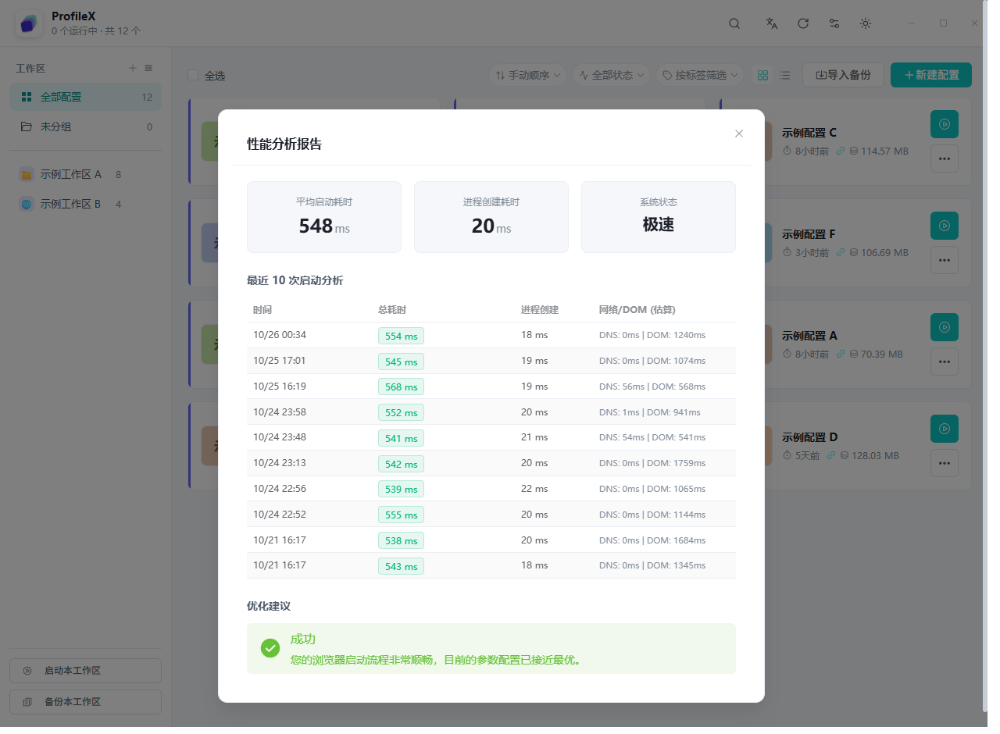
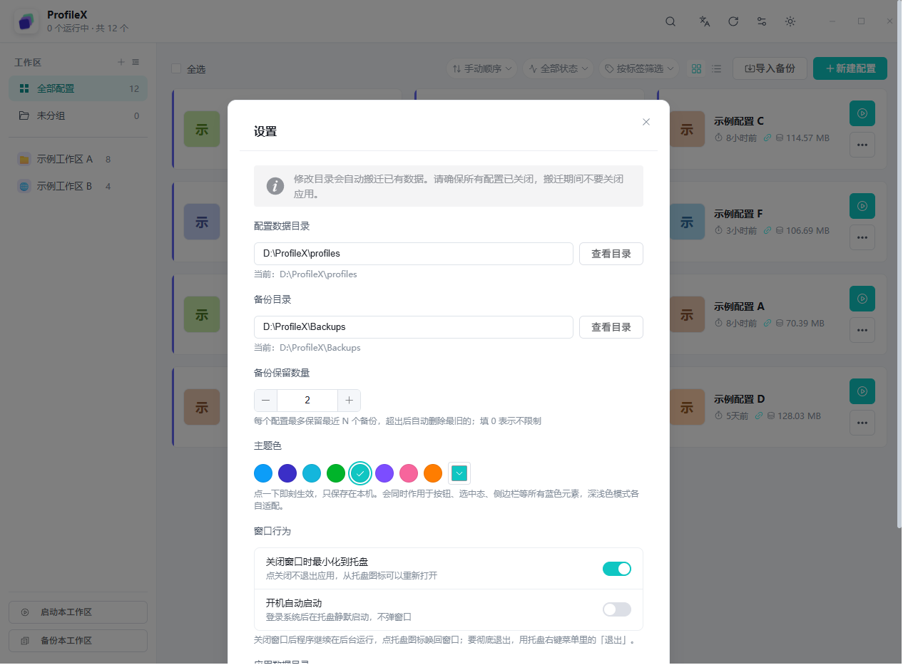

# ProfileX

> 多账号浏览器环境管理器 —— 一个配置一个独立身份，登录互不串味。

[](https://github.com/Dlany-Cohhh/ProfileX/releases)
[](#下载与安装)
[](https://tauri.app)
[](https://vuejs.org)
[](LICENSE)

[English](README_EN.md) | 简体中文

ProfileX 是一个基于 **Rust + Tauri v2 + Vue 3** 的桌面工具，用一份干净的界面管理几十个互相隔离的 Chrome 环境：每个配置有自己的用户数据目录、Cookie、扩展和启动参数，账号之间不会互相污染。全部数据留在本机 SQLite 里，不联网、不上传。



## 目录

- [功能特性](#功能特性)
- [界面预览](#界面预览)
- [下载与安装](#下载与安装)
- [快速上手](#快速上手)
- [功能说明](#功能说明)
- [数据与隐私](#数据与隐私)
- [从源码构建](#从源码构建)
- [技术栈](#技术栈)
- [致谢](#致谢)
- [许可证](#许可证)

## 功能特性

| 能力 | 说明 |
| --- | --- |
| **环境隔离** | 每个配置独立 `--user-data-dir`，Cookie / 缓存 / 扩展 / 登录态互不影响 |
| **工作区** | 侧边栏分组管理，支持未分组、图标与配色；一键启动或备份整个工作区 |
| **模板克隆** | 把调好的环境存为模板，新配置可「只带扩展与脚本」或「完整含登录态」克隆 |
| **批量操作** | 多选后批量启动 / 关闭 / 移动到工作区 / 清理缓存 / 备份 / 删除 |
| **启动参数** | 启动端口、CDP 调试端口与转发端口、Debugger 模式、禁用扩展、代理、UA、窗口尺寸 |
| **性能分析** | 记录每次启动耗时，拆分为进程创建 / DNS / DOM 估算，给出可执行的优化建议 |
| **备份恢复** | 单配置或整工作区打包为 zip（含配置元信息），可跨机器导入；支持保留 N 份自动清理 |
| **系统托盘** | 关闭窗口最小化到托盘、开机自启、托盘内直接启动常用配置 |
| **外观** | 8 种主题色 + 深浅色模式，配置支持自定义头像与图标颜色 |
| **双语界面** | 简体中文 / English 一键切换 |

## 界面预览

| 配置表单 | 性能分析 |
| --- | --- |
|  |  |

| 设置（目录 / 主题 / 窗口行为） |
| --- |
|  |

> 截图中的配置名、路径均为示例数据。

## 下载与安装

前往 [Releases](https://github.com/Dlany-Cohhh/ProfileX/releases) 下载最新的 Windows 安装包：

- `ProfileX_1.0.0_x64-setup.exe` —— NSIS 安装包，双击按提示安装（推荐）
- `ProfileX_1.0.0_x64_en-US.msi` —— MSI 安装包，适合批量部署

安装细节、SmartScreen 提示与卸载说明见 [docs/install.md](docs/install.md)。

**系统要求**：Windows 10 / 11（x64），本机需已安装 Google Chrome（未安装时也可在配置里手动指定其它 Chromium 内核浏览器路径）。

## 快速上手

1. 打开 ProfileX，点击右上角 **新建配置**。
2. 填一个名称，需要的话设置标签、备注、图标颜色；Chrome 路径留空即自动探测系统 Chrome。
3. 点配置卡片上的蓝色启动按钮，浏览器会以独立环境打开。
4. 想再开一个账号：直接再建一个配置，或用 **另存为模板** 克隆已有环境。
5. 常驻的配置建议放进工作区，之后用侧边栏底部按钮一键启动整组。

## 功能说明

### 工作区

左侧边栏管理分组。每个配置只能属于一个工作区，未分配的进「未分组」。工作区支持自定义图标与颜色，底部两个按钮分别用于**启动本工作区全部配置**和**备份本工作区**。

### 模板

任意配置都可以设为模板。新建时选择一个模板，两种模式：

- **仅扩展与脚本**：只复制扩展、书签等静态内容，登录态全新。
- **完整克隆**：连 Cookie 与登录态一起复制，相当于多开同一账号的独立副本。

### 启动参数

每个配置可单独设置：启动端口（不填自动分配）、CDP 调试端口、转发端口、Debugger 模式、禁用扩展、代理、User-Agent、窗口尺寸等，写法与 Chrome 命令行一致。

### 性能分析

启动时会记录进程创建、DNS、DOM 渲染各阶段耗时，并在「性能分析」里给出最近 10 次启动的对比和优化建议（例如扩展过多、端口冲突、代理慢）。数据只统计本机启动过程，不做任何上报。

### 备份与恢复

备份是一个 zip 包，内含浏览器用户数据 + 配置元信息（名称、图标、标签、端口、启动参数、所属工作区）。因此把一个备份发给别人或换台机器导入，配置的「外观和参数」也会一起还原。可在设置里指定备份目录与保留份数（0 表示不限制）。

## 数据与隐私

- 配置数据存放在本机 SQLite：`%APPDATA%\com.bujic.profilex\profiles.db`。
- 浏览器数据默认在 `%APPDATA%\com.bujic.profilex\profiles\`，可在设置里改到其它磁盘。
- 备份默认在 `文档\ProfileX\Backups\`。
- 应用不含任何统计、遥测或云同步逻辑，只有在你手动点击「测试代理」时才会发起一次网络请求。

## 从源码构建

需要 Node.js 20+ 和 Rust stable（Windows 上需 MSVC 工具链）。

```bash
git clone https://github.com/Dlany-Cohhh/ProfileX.git
cd ProfileX
yarn install
yarn tauri dev      # 开发模式
yarn tauri build    # 生产构建，产物在 src-tauri/target/release/bundle/
```

辅助脚本：

```bash
yarn check:i18n     # 校验中英文案是否一一对应
npx vue-tsc --noEmit  # 类型检查
```

## 技术栈

| 层 | 选型 |
| --- | --- |
| 桌面壳 | Tauri v2（Rust） |
| 前端 | Vue 3 + TypeScript + Vite + Pinia |
| UI | Element Plus + 自定义主题变量 |
| 数据 | SQLite（rusqlite）+ zip 备份 |
| 浏览器控制 | Chrome DevTools Protocol |

## 致谢

ProfileX 是基于 [chao-eng/SpaceShift](https://github.com/chao-eng/SpaceShift) 的**二次开发**版本。

感谢原作者 [@chao-eng](https://github.com/chao-eng) 开源了 SpaceShift —— 它的整体架构、配置隔离思路与备份格式设计是 ProfileX 的起点。本项目在其基础上重做了界面与交互，并补充了列表筛选、性能分析、主题与工作区体验等改进。

同时感谢这些开源项目：Tauri、Vue、Element Plus、rusqlite、zip-rs、walkdir、chrono。

## 许可证

[MIT](LICENSE) © 2026 bujic
